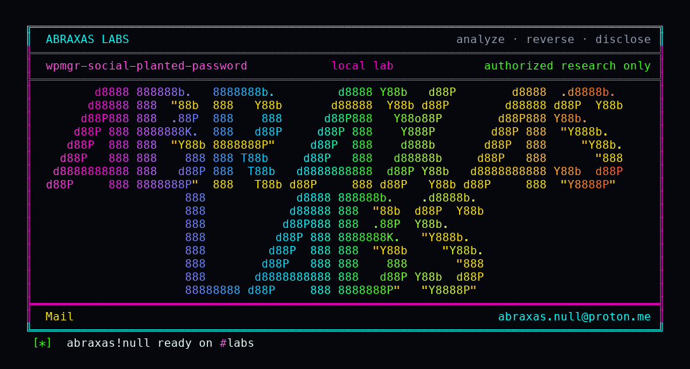

<p align="center">
  
</p>

# wpmgr-social-planted-password

Someone who knows your email can register it first, set a password you never chose, and wait. When you later click the verification mail and sign in with Google or GitHub, WPMgr links that identity onto the planted row and leaves the attacker's password in place. They then log in as you with the password they picked. This is after the install is claimed. It needs you to verify the address. It does not need them inside your mailbox if you click the mail yourself.

**Class:** OAuth leftover (account linking)
**Reach:** Remote (self-serve registrant after claim; victim verifies email)

**WPMgr** `v0.61.199` (`e1b3a163`) - mosamlife

| | |
|---|---|
| ID | no CVE yet |
| Class | **OAuth leftover** (social link onto a planted password) |
| Reach | **Remote** (untrusted self-serve after the install is claimed) |
| CWE | [CWE-287](https://cwe.mitre.org/data/definitions/287.html) / [CWE-284](https://cwe.mitre.org/data/definitions/284.html) |
| CVSS | **High: 8.1** `CVSS:3.1/AV:N/AC:L/PR:N/UI:R/S:U/C:H/I:H/A:N` |
| Product | [WPMgr](https://github.com/mosamlife/wpmgr) |
| Affected | **v0.61.199** (`e1b3a163988c9f1c31bc93922ea34322fa188792`) |
| Auth | none to plant. Victim clicks the verification mail. Later victim SSO. |
| License | [GNU Affero GPL v3.0](LICENSE) |
| Lab | loopback 127.0.0.1:18180-18186. Compose `wpmgrh04`. |

## What an attacker can do

Needs an install that already has an owner (self-serve is open after claim) and the victim's email address. The victim has to verify that address. SSO-only rows with an empty `password_hash` are a different story.

| Privilege | Method / sink | Recon / integrity / availability | Lab-proven or inferred |
|---|---|---|---|
| Plant a pending user with an attacker-chosen argon2 password | `POST /auth/register` for the victim email | Integrity (account plant) | Lab-proven. Row `pending\|hash\|unverified` |
| Mail a verification token for that planted row | unauthenticated `ResendVerification` / register mail | Recon (token in mail) | Lab-proven. Mailpit captured `verify-email?token=` |
| Activate the planted row without clearing the hash | `POST /auth/verify-email` → `MarkUserEmailVerified` | Integrity | Lab-proven. Row `active\|hash\|verified` |
| Bind Google / GitHub / OIDC onto that same row | `GET /auth/oidc/callback` → `CompleteSocialLink` | Integrity (identity link) | Lab-proven. `oidc\|victim.h04@lab.test` |
| Sign in as the victim with the planted password after SSO | `POST /auth/login` email + attacker password | Integrity (session as victim) | Lab-proven. `wpmgr_session`, identities still show oidc |
| Negative control: plant without verify | OIDC start on a pending row | n/a | Source. `socialStatusGate` returns `email_not_verified` |

**Stays closed on this leftover**

| Axis | Method / sink | Why it is closed |
|---|---|---|
| Integrity | SSO-only victim with empty `password_hash` | No planted hash to keep. Out of class |
| Integrity | MCP OAuth register / token / consent | PKCE S256, exact redirect, consent behind `PermAPIKeyManage` |
| Integrity | Unclaimed first-run | Bootstrap claim still required before self-serve |
| Integrity | Password reset as a session mint | Reset does not issue `wpmgr_session` |

I ran this as a loopback compose with Dex standing in for Google. The interesting bit was not the plant. It was `MarkUserEmailVerified` leaving `password_hash` alone, so the SSO link never converted the row to social-only.

## How I found it

Pin [mosamlife/wpmgr](https://github.com/mosamlife/wpmgr) tag `v0.61.199`. `decideSocial` already names this pre-hijack and refuses to link until the address is verified. The pending gate fires first, so the dashboard copy that would tell the victim to reset a password they did not set never shows. Verify only flips `email_verified_at` and `status=active`. The next OIDC callback hits `socialLinkExisting`.

Wrong turns: treating MCP OAuth open client registration as this leftover (it is bounded to a row); treating SSO-only empty-hash accounts as in scope.

## Lab

```bash
python3 wpmgr-social-planted-password-Abraxas-Labs.py
```

or:

```bash
cd lab
./run.sh
```

Clones [mosamlife/wpmgr](https://github.com/mosamlife/wpmgr) at `e1b3a163` into `lab/src`, builds `wpmgr-lab:v0.61.199` / `wpmgr-lab-web:v0.61.199` if missing, and talks to loopback. Docker, python3, git. Mailpit sits on `1.2.3.0/24` because the product SMTP dialer refuses RFC1918 and loopback.

```text
IOC planted-pending pending|hash|unverified
IOC email-verified-hash-kept active|hash|verified
IOC oidc-linked oidc|victim.h04@lab.test
IOC password-login-survived active|hash|verified oidc|victim.h04@lab.test
SUCCESS WPMGR-H04-SOCIAL-PLANT planted-password-survives-oidc-link WPMGR-H04-PLANTED-PASSWORD-SURVIVES
```

## The fix

On verify, and again in `CompleteSocialLink`, clear `password_hash` (or force a reset) when the row was never used for a password login the owner chose. Do not link a provider onto a hash the current user did not set. Show the reset copy on the pending path, not only after a status that never happens.

## References

- [github.com/mosamlife/wpmgr](https://github.com/mosamlife/wpmgr) `e1b3a163988c9f1c31bc93922ea34322fa188792`
- [`decideSocial` / `CompleteSocialLink`](https://github.com/mosamlife/wpmgr/blob/e1b3a163988c9f1c31bc93922ea34322fa188792/apps/api/internal/auth/social.go)
- [`MarkUserEmailVerified`](https://github.com/mosamlife/wpmgr/blob/e1b3a163988c9f1c31bc93922ea34322fa188792/apps/api/internal/auth/register.go)
- [CWE-287](https://cwe.mitre.org/data/definitions/287.html) · [CWE-284](https://cwe.mitre.org/data/definitions/284.html)

## License

GNU Affero GPL v3.0. See [LICENSE](LICENSE). Loopback lab only. No warranty.

Abraxas Labs
abraxas.null@proton.me
